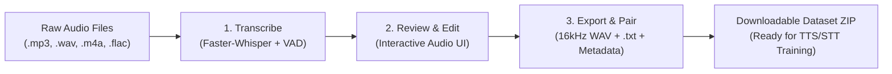

<div align="center">

# 🎙️ Transcribe Studio
### *Audio-to-Dataset Pipeline for Speech Recognition, TTS & Voice AI*

[](https://www.python.org/)
[](https://gradio.app/)
[](https://github.com/SYSTRAN/faster-whisper)
[](LICENSE)
[](https://github.com/Sagar-Sonewane/transcribe_studio)

<p align="center">
  <b>Transcribe Studio</b> is an intuitive, local-first web application designed to turn raw audio recordings into production-ready, paired voice datasets for speech-to-text (STT), text-to-speech (TTS), and voice cloning models.
</p>

</div>

---

## 📑 Table of Contents
- [✨ Key Features](#-key-features)
- [🏗️ Pipeline & Workflow](#️-pipeline--workflow)
- [🚀 Quick Start](#-quick-start)
- [📂 Output Dataset Structure](#-output-dataset-structure)
- [⚙️ Model Selection & Benchmarks](#️-model-selection--benchmarks)
- [🛠️ Configuration & Options](#️-configuration--options)
- [🧩 Prerequisites & System Setup](#-prerequisites--system-setup)
- [🤝 Contributing](#-contributing)
- [📄 License](#-license)

---

## ✨ Key Features

- ⚡ **Ultra-Fast Local Transcription**: Powered by [faster-whisper](https://github.com/SYSTRAN/faster-whisper) (CTranslate2 engine), offering up to **4x speedup** compared to vanilla Whisper with reduced VRAM usage.
- 🔒 **100% Offline & Private**: Zero external API calls. All audio stays local on your machine.
- 🎧 **Interactive Review Player**: Click any row in the interactive table to immediately listen to the audio preview and edit the corresponding transcript inline.
- 🏷️ **Intelligent Dataset Pairing**: Automatically renames audio and `.txt` files with matching identifiers (`clip_0001.wav` + `clip_0001.txt`).
- 🧹 **Text Normalization**: Configurable lowercase transformation, punctuation stripping, and whitespace cleanup.
- 🎛️ **Audio Standardization**: Optional automatic conversion to standard machine learning format (**16 kHz mono WAV**) using FFmpeg.
- 📊 **Multi-Format Metadata**: Generates LJSpeech-style `metadata.csv` (pipe-separated) and `metadata.jsonl` with duration metadata.
- 📦 **Instant ZIP Packaging**: Packages your curated dataset into a single downloadable `.zip` archive.
- 🛡️ **Zero Data Loss & Collision Prevention**: Built-in collision handling (`_dup2`, `_dup3`) and graceful CPU fallback if CUDA libraries are missing.

---

## 🏗️ Pipeline & Workflow



### 1. Upload & Transcribe
Drop multiple audio files of any standard format (`.mp3`, `.wav`, `.m4a`, `.ogg`, `.flac`). Select your model size and device (CPU or CUDA GPU), configure Voice Activity Detection (VAD) to ignore silence, and hit **Transcribe**.

### 2. Review & Refine
As soon as transcription finishes, the UI switches automatically to the **Review** tab. Click on any row to play the audio in the embedded media player, and correct any words directly inside the editable data grid.

### 3. Rename, Pair & Export
Configure your dataset naming convention (sequential prefix, zero-padded numbering, slugified transcript tags, or original filenames), choose audio conversion settings, and export your structured dataset and ZIP archive.

---

## 🚀 Quick Start

### 1. Clone the Repository
```bash
git clone https://github.com/Sagar-Sonewane/transcribe_studio.git
cd transcribe_studio
```

### 2. Create and Activate a Virtual Environment

**Windows (PowerShell):**
```powershell
python -m venv venv
.\venv\Scripts\Activate.ps1
```

**Linux / macOS:**
```bash
python3 -m venv venv
source venv/bin/activate
```

### 3. Install Dependencies
```bash
pip install -r requirements.txt
```

### 4. Run the Application
```bash
python audio_transcriber_ui.py
```
Open your browser and navigate to: **`http://127.0.0.1:7860`**

---

## 📂 Output Dataset Structure

Transcribe Studio generates clean, structured directories compatible with standard Voice AI pipelines (such as Coqui TTS, Piper, Tortoise, Whisper fine-tuning, and FastSpeech2):

```
dataset/
├── clip_0001.wav          # Audio file (converted or original)
├── clip_0001.txt          # Matching transcript
├── clip_0002.wav
├── clip_0002.txt
├── clip_0003.wav
├── clip_0003.txt
├── metadata.csv           # Pipe-delimited dataset index
└── metadata.jsonl         # JSON Lines index with audio durations
```

#### `metadata.csv` (LJSpeech format)
```csv
file|transcript
clip_0001.wav|The quick brown fox jumps over the lazy dog.
clip_0002.wav|Welcome to Transcribe Studio.
```

#### `metadata.jsonl`
```json
{"file": "clip_0001.wav", "transcript": "The quick brown fox jumps over the lazy dog.", "original": "raw_sample_1.mp3", "seconds": 3.4}
{"file": "clip_0002.wav", "transcript": "Welcome to Transcribe Studio.", "original": "raw_sample_2.mp3", "seconds": 2.1}
```

---

## ⚙️ Model Selection & Benchmarks

Models are automatically downloaded from Hugging Face on first use and cached locally in your specified directory (default: `D:/whisper_models` or `./whisper_models`).

| Model | Disk Size | Required VRAM / RAM | Recommended Use Case |
| :--- | :---: | :---: | :--- |
| **`tiny.en`** | ~75 MB | ~1 GB | Real-time testing, ultra-low resource environments |
| **`base.en`** | ~145 MB | ~1 GB | Fast rough drafts with good accuracy |
| **`small.en`** | ~485 MB | ~2 GB | **Recommended balance** of speed and high precision |
| **`medium.en`** | ~1.5 GB | ~5 GB | Complex vocabulary, noisy background audio |
| **`distil-large-v3`** | ~1.5 GB | ~4 GB | Near large-v3 accuracy at 6x inference speed |
| **`large-v3`** | ~3.0 GB | ~6 GB | State-of-the-art maximum transcription accuracy |

---

## 🛠️ Configuration & Options

| Category | Option | Description |
|---|---|---|
| **Transcription** | `Model` | Choose from `tiny.en` up to `large-v3` |
| | `Device` | `cpu`, `cuda` (NVIDIA GPU), or `auto` |
| | `Beam Size` | 1–10 (Higher values increase accuracy at slight speed cost) |
| | `VAD Filter` | Skips non-speech/silence sections |
| | `Natural Sort` | Ensures natural order (`clip2` precedes `clip10`) |
| **Naming** | `Sequential` | e.g. `clip_0001.wav` + `clip_0001.txt` |
| | `Sequential + Words`| e.g. `clip_0001_hello_world.wav` |
| | `Keep Original` | Preserves original audio stem names |
| **Formatting** | `Audio Mode` | Copy as-is or convert to 16 kHz Mono WAV |
| | `Lowercase` | Normalizes all transcript letters to lowercase |
| | `Strip Punctuation` | Strips special punctuation characters |
| | `Skip Empty` | Omits silent or blank transcripts from the output |

---

## 🧩 Prerequisites & System Setup

### Optional: FFmpeg (For 16 kHz Audio Conversion)
If you enable the **"Convert to 16 kHz mono WAV"** option, ensure `ffmpeg` is installed and accessible in your system `PATH`:

- **Windows (Scoop / Chocolatey / Winget)**:
  ```powershell
  winget install Gyan.FFmpeg
  # or
  choco install ffmpeg
  ```
- **Linux (Debian/Ubuntu)**:
  ```bash
  sudo apt update && sudo apt install ffmpeg -y
  ```
- **macOS (Homebrew)**:
  ```bash
  brew install ffmpeg
  ```

---

## 🤝 Contributing

Contributions, feature requests, and issue reports are very welcome!

1. Fork the Project
2. Create your Feature Branch (`git checkout -b feature/AmazingFeature`)
3. Commit your Changes (`git commit -m 'Add some AmazingFeature'`)
4. Push to the Branch (`git push origin feature/AmazingFeature`)
5. Open a Pull Request

---

## 📄 License

Distributed under the MIT License. See [`LICENSE`](LICENSE) for details.

---

<div align="center">
  <sub>Built with ❤️ by <a href="https://github.com/Sagar-Sonewane">Sagar Sonewane</a></sub>
</div>
